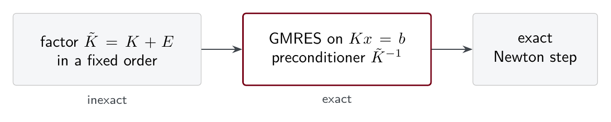
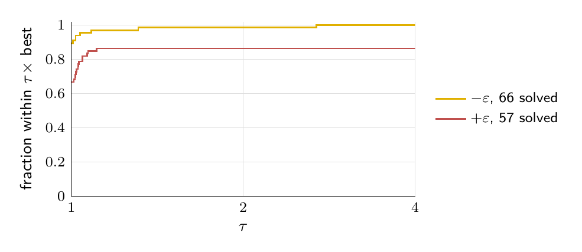
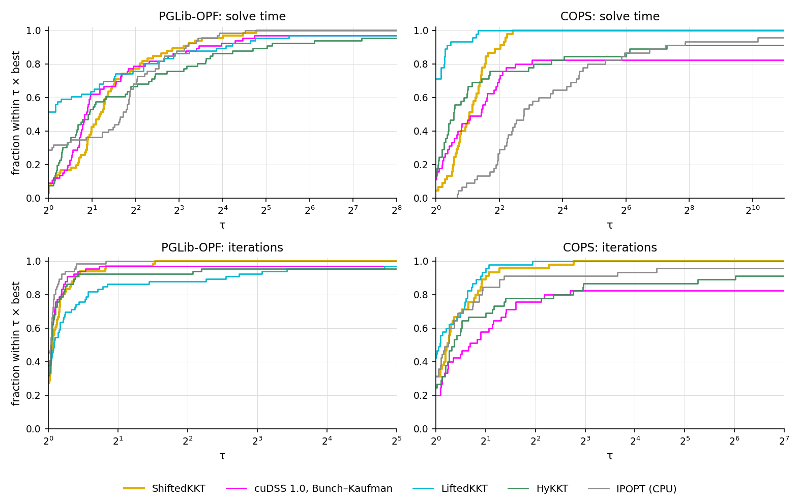
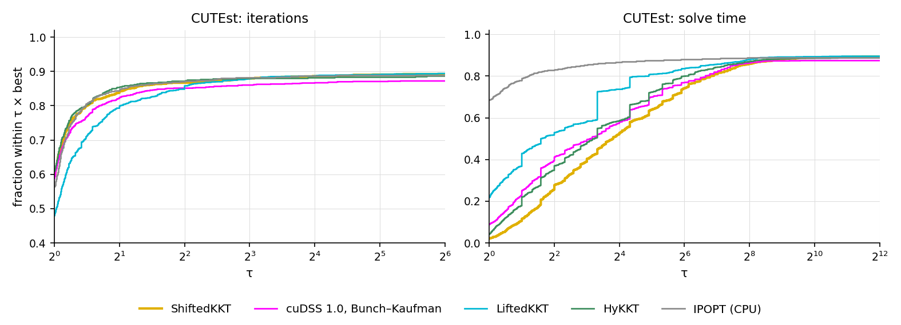

GPU sparse solvers fix the pivot order before they see any values, so on the indefinite KKT matrices of nonlinear interior-point methods they meet tiny pivots that must be perturbed. We factor the perturbed matrix, recover the Newton step of the original one by GMRES, and show that replacing every tiny pivot by a negative number keeps the inertia test of the method valid. In MadNLP on an NVIDIA GPU, the resulting solver, ShiftedKKT, solves all 66 PGLib-OPF cases and all 45 COPS instances, and is the fastest of five solvers on PGLib-OPF.

## 1. Introduction

An interior-point method for nonlinear optimization solves one linear system per iteration, with the Karush–Kuhn–Tucker (KKT) matrix of the current iterate. The factorization of that matrix is the main cost. In MadNLP with MA27 on a CPU, it takes 82% of the solve time on the PGLib-OPF power flow cases, 93% on COPS and 91% on CUTEst. A faster factorization therefore means a faster method, and GPUs factor large sparse matrices quickly.

The difficulty is pivoting. The KKT matrix of a nonconvex problem is indefinite, and CPU solvers such as MA27 and MA57 choose each pivot from the values as they factor [1]. GPU solvers fix the pivot order from the sparsity pattern, before the numerical factorization starts. A pivot that is zero or tiny in that order cannot be avoided, so the solver perturbs it, and both the factors and the inertia it reports belong to a perturbed matrix.

Most GPU interior-point methods avoid the problem by condensing the KKT system into a positive definite one [2]. We keep the augmented system instead. Our contributions are the following.

1. We factor the perturbed matrix in a fixed order and recover the Newton step of the original matrix by right-preconditioned GMRES.
2. We show which diagonal perturbations keep the inertia test meaningful. Perturbing downward never breaks it, and a positive perturbation of the dual block can hide negative curvature of any size.
3. We give the resulting rule, every tiny pivot becomes −ε, and compare the solver with four others on 1,448 problems.

## 2. Background

### 2.1 The KKT system and the inertia test

For a problem with n variables and m equality constraints (inequalities enter through slacks and barrier terms), each Newton step solves a system with

```text
K = [ H   Jᵀ ]
    [ J   0  ]
```

where H is the Hessian of the Lagrangian plus the barrier terms and J is the constraint Jacobian. Let Z be an orthonormal basis of the null space of J. When ZᵀHZ is positive definite, the quadratic model behind the step has positive curvature along the constraints. At an iterate that satisfies the constraints, this makes the step a descent direction for the barrier objective, and in general it is the condition the line search of IPOPT relies on. IPOPT [3] and MadNLP read it from the inertia of K, the numbers of its positive, zero and negative eigenvalues. If the factorization reports (n, 0, m), the inertia test passes. Otherwise a multiple δ of the identity is added to H and K is factored again, and in what follows H includes this term. The test rests on a classical identity [4]. If J has rank r, the number of positive eigenvalues of K equals r plus the number of positive eigenvalues of ZᵀHZ, so K has n positive eigenvalues exactly when ZᵀHZ is positive definite. The full inertia (n, 0, m) also forces J to have full row rank.

### 2.2 Static factorization on a GPU

An LDLᵀ factorization eliminates one variable at a time and divides by a diagonal entry, the pivot. Dynamic pivoting decides the order during the factorization. When the next pivot is tiny it picks a larger 1×1 pivot or a 2×2 block instead, and if no good pivot is available it delays the column to a later front. This works for every indefinite matrix, but each decision depends on the numbers computed so far, which maps badly onto a GPU.

A GPU solver computes the order once from the sparsity pattern with an ordering such as AMD or METIS, does the symbolic analysis once, and then runs the same parallel kernels at every iteration. A quasi-definite matrix, one with a positive definite top-left block and a negative definite bottom-right block, can be factored in any symmetric order without a zero pivot [5]. The KKT matrix, with an indefinite H and a zero bottom-right block, is not quasi-definite, so a pivot in the fixed order can be zero or tiny.

### 2.3 Condensed systems

HyKKT [6] factors H + γJᵀJ for a large γ by Cholesky and recovers the multipliers by conjugate gradients. This needs ZᵀHZ to be positive definite and J to have full row rank. LiftedKKT [7] relaxes each equality constraint into two inequalities, eliminates the slacks and factors a condensed matrix by Cholesky. It therefore solves a slightly perturbed problem. Both avoid pivoting altogether, and both work well on many problems [2]. Our question is whether the augmented K can be factored directly.

## 3. Method

ShiftedKKT replaces the linear solver of MadNLP. At each factorization it does three things.

1. It equilibrates K by four Ruiz sweeps, giving a scaled matrix WKW with W diagonal.
2. It factors the scaled matrix in the fixed nested-dissection order. Every pivot d with \|d\| < ε becomes −ε, whatever its sign, with ε = 1e-10. In exact arithmetic and scaled back by W, the factors are exact for a perturbed matrix K + E, where E is diagonal, negative semidefinite and nonzero only at the replaced pivots. The inertia passed to MadNLP is read from the signs of the pivots, and it is the inertia of K + E because the scaling does not change it.
3. Each linear solve runs restarted GMRES on the original system Kx = b, right-preconditioned by the inverse of K + E, which the factors and W apply. The solve is accepted when the componentwise backward error falls below 1e-6, with at most two cycles of 25 iterations.

Right preconditioning matters here. Within each restart cycle GMRES then minimizes the residual of Kx = b itself, so the step returned to MadNLP solves the original system up to the backward-error tolerance, not the system with K + E, in the spirit of static pivoting followed by Krylov refinement [8]. On PGLib-OPF a linear solve applies the factors 7.3 times on average.



**Figure 1.** The factors of the perturbed matrix precondition GMRES on the original system.

## 4. Which way should a tiny pivot go?

The inertia that MadNLP reads now belongs to K + E. The question is which perturbations E still let it certify that ZᵀHZ is positive definite. We call the top-left block of K the primal block and the bottom-right block the dual block. Table 1 summarizes what an inertia of (n, 0, m) for K + E guarantees about K, in exact arithmetic.

**Table 1.** What the inertia test still guarantees under a diagonal perturbation E.

| Perturbation E | Inertia (n, 0, m) of K + E guarantees |
|---|---|
| none | ZᵀHZ ≻ 0 |
| primal block, negative | ZᵀHZ ≻ 0 |
| primal block, positive, at most θ | ZᵀHZ ≻ −θI |
| dual block, negative | ZᵀHZ ≻ 0 |
| dual block, positive | no curvature guarantee |

**Downward perturbations are safe.** Suppose E ⪯ 0 and K + E has n positive eigenvalues. Since K = (K + E) − E ⪰ K + E, Weyl's inequality gives every eigenvalue of K at least as large as the corresponding eigenvalue of K + E. So K also has at least n positive eigenvalues, and by the identity of Section 2.1, ZᵀHZ is positive definite. A positive primal perturbation of size at most θ shifts H by at most θ, which explains the third row.

**A positive dual perturbation is not.** Take one variable and one constraint whose Jacobian row is zero, with H = −h for some h > 0. Then Z spans the whole space and ZᵀHZ = −h < 0. The matrix K has the diagonal entries −h and 0. Replacing the zero pivot by +ε gives the inertia (1, 0, 1), which is exactly (n, 0, m), so the test passes despite the reduced curvature −h, however large h is. The same happens with a Jacobian of full row rank and an arbitrarily small ε, for suitable H.

This is the case that standard static pivoting gets wrong. Static pivoting keeps the sign of a small pivot and turns an exact zero into +ε [9]. In a KKT matrix, a constraint row eliminated before any of its variables has the pivot 0, its diagonal entry, and static pivoting makes it positive. ShiftedKKT sends every tiny pivot down instead, so E ⪯ 0 and the first row of the argument applies. No dual shift and no sign test are needed.

The sign makes a difference in practice. We ran the solver on the 66 PGLib-OPF cases with three replacement rules and everything else unchanged, without the dual shift and with left-preconditioned GMRES.

| Rule for a pivot below ε | Cases solved | Iterations (SGM10) |
|---|---:|---:|
| every tiny pivot becomes −ε | **66** | **56** |
| every tiny pivot becomes +ε | 57 | 91 |
| keep the sign, 0 becomes +ε (static pivoting) | 46 | 180 |

Unsolved cases count as 3,000 iterations. Figure 2 shows the iteration profile of the first two rules.



**Figure 2.** Iteration performance profile of the two replacement rules on the 66 PGLib-OPF cases.

## 5. Experiments

### 5.1 Setup

We compare five ways of computing the step inside the same interior-point method, MadNLP.

- **ShiftedKKT** (this work), on the GPU.
- **cuDSS 1.0 with Bunch–Kaufman pivoting** on the augmented system, on the GPU, with matching and with the analysis redone when MadNLP's iterative refinement rejects a solve.
- **LiftedKKT** [7] on the GPU, which relaxes each equality constraint by 1e-8 times the larger of one and the magnitude of its right-hand side and factors the condensed matrix by Cholesky.
- **HyKKT** [6] on the GPU, which factors H + 10⁷ JᵀJ and computes the multipliers by conjugate gradients.
- **IPOPT** [3] on the CPU, with MA27 on PGLib-OPF and CUTEst and MA57 on COPS.

The test sets are the 66 PGLib-OPF AC optimal power flow cases in polar form and 45 COPS instances, both evaluated on the GPU by ExaModels, and 1,337 CUTEst problems with at most 10⁵ variables and 10⁵ constraints and no more equality constraints than variables, evaluated on the CPU. Every solver starts from the initial point of the model and uses a tolerance of 1e-8, at most 3,000 iterations and a limit of 900 seconds. A problem counts as solved when the solver stops at its optimal or acceptable level within the limit. An untimed warm-up run precedes each timed run to exclude compilation. Times and iterations are summarized by the shifted geometric mean with a shift of 10 (SGM10), with an unsolved instance charged the time limit. Instances are grouped by the number of nonzeros in the KKT matrix into small (fewer than 2¹⁸), medium (fewer than 2²⁰) and large. All runs use two Intel Xeon Gold 6130 CPUs and two NVIDIA Quadro GV100 GPUs. The comparison mixes CPU and GPU solvers, and LiftedKKT solves a relaxed problem, so it shows what each method achieves under one protocol rather than ranking the methods.

### 5.2 PGLib-OPF and COPS

Table 2 reports the problems solved and the SGM10 of the solve time in seconds by size class, and Figure 3 shows performance profiles of the time and of the iterations. The best value in each column is in bold. PGLib-OPF has 31 small, 24 medium and 11 large cases, and COPS has 13, 16 and 16.

**Table 2.** PGLib-OPF and COPS: problems solved and SGM10 of the solve time in seconds, by size class.

| set | solver | small: solved | time | medium: solved | time | large: solved | time | total: solved | time |
|---|---|---:|---:|---:|---:|---:|---:|---:|---:|
| PGLib-OPF | ShiftedKKT | **31** | 0.54 | **24** | **2.57** | **11** | 13.22 | **66** | **2.82** |
|  | cuDSS 1.0, Bunch–Kaufman | **31** | **0.47** | 23 | 4.59 | 10 | 24.65 | 64 | 4.42 |
|  | LiftedKKT | 30 | 2.45 | **24** | 3.04 | 10 | **11.61** | 64 | 3.88 |
|  | HyKKT | **31** | 0.63 | **24** | 2.62 | 8 | 72.14 | 63 | 5.91 |
|  | IPOPT (CPU) | **31** | 0.61 | **24** | 6.46 | **11** | 43.52 | **66** | 6.30 |
| COPS | ShiftedKKT | **13** | 1.25 | **16** | 3.39 | **16** | 7.87 | **45** | 4.11 |
|  | cuDSS 1.0, Bunch–Kaufman | **13** | 1.00 | 11 | 35.82 | 13 | 29.94 | 37 | 18.90 |
|  | LiftedKKT | **13** | **0.48** | **16** | **1.67** | **16** | **4.56** | **45** | **2.24** |
|  | HyKKT | 12 | 8.77 | 15 | 9.32 | 14 | 17.38 | 41 | 11.69 |
|  | IPOPT (CPU) | **13** | 7.77 | 15 | 19.08 | 15 | 48.21 | 43 | 22.28 |

ShiftedKKT solves all 66 PGLib-OPF cases and all 45 COPS instances. LiftedKKT misses two PGLib-OPF cases, IPOPT misses two COPS instances, and HyKKT misses three large PGLib-OPF cases and four COPS instances. Bunch–Kaufman pivoting in cuDSS misses two PGLib-OPF cases and eight COPS instances, among them all five bearing instances, which it declares infeasible.



**Figure 3.** Performance profiles of the solve time (top) and the iterations (bottom) on PGLib-OPF (left) and COPS (right). A curve gives the fraction of instances that a solver solves within a factor τ of the best of the five, and an unsolved instance counts as beyond every τ.

ShiftedKKT has the lowest SGM10 time on PGLib-OPF as a whole, and LiftedKKT is faster on the large PGLib-OPF cases and on all of COPS. Instance by instance on the problems that both solve, LiftedKKT takes 0.72 times the time of ShiftedKKT in geometric mean on PGLib-OPF and 0.52 times on COPS. LiftedKKT factors a condensed matrix of order n by Cholesky, whereas ShiftedKKT factors the augmented matrix of order n + m and applies its factors 7.3 times per linear solve on PGLib-OPF and 5.0 times on COPS. LiftedKKT also solves a relaxed problem, and it needs more iterations on PGLib-OPF. Over the 60 PGLib-OPF cases that all five solve, IPOPT takes 48.6 iterations in SGM10, cuDSS 49.6, ShiftedKKT and HyKKT 52.0, and LiftedKKT 67.0. Over the 33 COPS instances that all five solve, LiftedKKT takes 33.5, ShiftedKKT 35.6, IPOPT 40.1, cuDSS 43.8 and HyKKT 54.2.

### 5.3 CUTEst

Table 3 summarizes the 1,337 CUTEst problems and Figure 4 shows the performance profiles.

**Table 3.** CUTEst: problems solved and solved at the optimal level, SGM10 of the time over all problems, and geometric mean of the time and SGM10 of the iterations over the 1,076 problems that all five solve.

| solver | solved | optimal | time, all (s) | mean time, common (s) | iterations, common |
|---|---:|---:|---:|---:|---:|
| ShiftedKKT | 1,195 | 1,175 | 9.78 | 0.32 | 23.2 |
| cuDSS 1.0, Bunch–Kaufman | 1,169 | 1,157 | 10.05 | 0.19 | 23.6 |
| LiftedKKT | **1,197** | 1,165 | 9.59 | 0.10 | 25.4 |
| HyKKT | 1,186 | 1,163 | 11.30 | 0.19 | **23.0** |
| IPOPT (CPU) | 1,190 | **1,177** | **8.98** | **0.03** | 23.2 |

ShiftedKKT solves 1,195 problems (1,175 at the optimal level), LiftedKKT 1,197 (1,165), IPOPT 1,190 (1,177), HyKKT 1,186 (1,163) and cuDSS 1,169 (1,157). These differences are small relative to the size of the collection. Over the problems that all five solve, ShiftedKKT matches the iteration count of IPOPT. Most CUTEst problems are small, however, and on them a GPU solver pays fixed costs per factorization and per application of the factors that a CPU solver does not. ShiftedKKT is the slowest per problem, with a geometric mean of 0.32 seconds against 0.03 for IPOPT and 0.10 for LiftedKKT.



**Figure 4.** CUTEst: performance profiles of the iterations (left, fractions above 0.4) and of the solve time (right) on the 1,337 problems. An unsolved problem counts as beyond every τ.

## 6. Conclusion

On a GPU the pivot order of the KKT factorization is fixed before the values are known, so tiny pivots have to be perturbed. ShiftedKKT accepts this. It factors the inexact matrix, solves the exact system by GMRES preconditioned with those factors, and replaces every tiny pivot by −ε so that the inertia test still certifies positive curvature along the constraints. The augmented system then becomes a practical choice on the GPU, as robust as IPOPT on PGLib-OPF and as LiftedKKT on COPS, without a relaxed problem, and its curvature guarantee needs no rank assumption.

The solver runs in Julia. The interior-point method is [MadNLP.jl](https://github.com/MadNLP/MadNLP.jl), GMRES comes from [Krylov.jl](https://github.com/JuliaSmoothOptimizers/Krylov.jl), and the models are evaluated on the GPU by [ExaModels.jl](https://github.com/exanauts/ExaModels.jl). The ShiftedKKT code will be released with the paper.

## References

1. I. S. Duff and J. K. Reid. The multifrontal solution of indefinite sparse symmetric linear equations. *ACM Transactions on Mathematical Software*, 9(3), 1983.
2. F. Pacaud, S. Shin, A. Montoison, M. Schanen and M. Anitescu. [Condensed-space methods for nonlinear programming on GPUs](https://arxiv.org/abs/2405.14236). arXiv:2405.14236.
3. A. Wächter and L. T. Biegler. On the implementation of an interior-point filter line-search algorithm for large-scale nonlinear programming. *Mathematical Programming*, 106, 2006.
4. N. I. M. Gould. On practical conditions for the existence and uniqueness of solutions to the general equality quadratic programming problem. *Mathematical Programming*, 32, 1985.
5. R. J. Vanderbei. Symmetric quasidefinite matrices. *SIAM Journal on Optimization*, 5(1), 1995.
6. S. Regev, N.-Y. Chiang, E. Darve, C. G. Petra, M. A. Saunders, K. Świrydowicz and S. Peleš. [A hybrid direct-iterative method for solving KKT linear systems](https://arxiv.org/abs/2110.03636). *Optimization Methods and Software*, 38(2), 2023.
7. S. Shin, F. Pacaud and M. Anitescu. [Accelerating optimal power flow with GPUs: SIMD abstraction of nonlinear programs and condensed-space interior-point methods](https://arxiv.org/abs/2307.16830). *Electric Power Systems Research*, 236, 2024.
8. M. Arioli, I. S. Duff, S. Gratton and S. Pralet. A note on GMRES preconditioned by a perturbed LDLᵀ decomposition with static pivoting. *SIAM Journal on Scientific Computing*, 29(5), 2007.
9. X. S. Li and J. W. Demmel. Making sparse Gaussian elimination scalable by static pivoting. *Proceedings of Supercomputing*, 1998.
